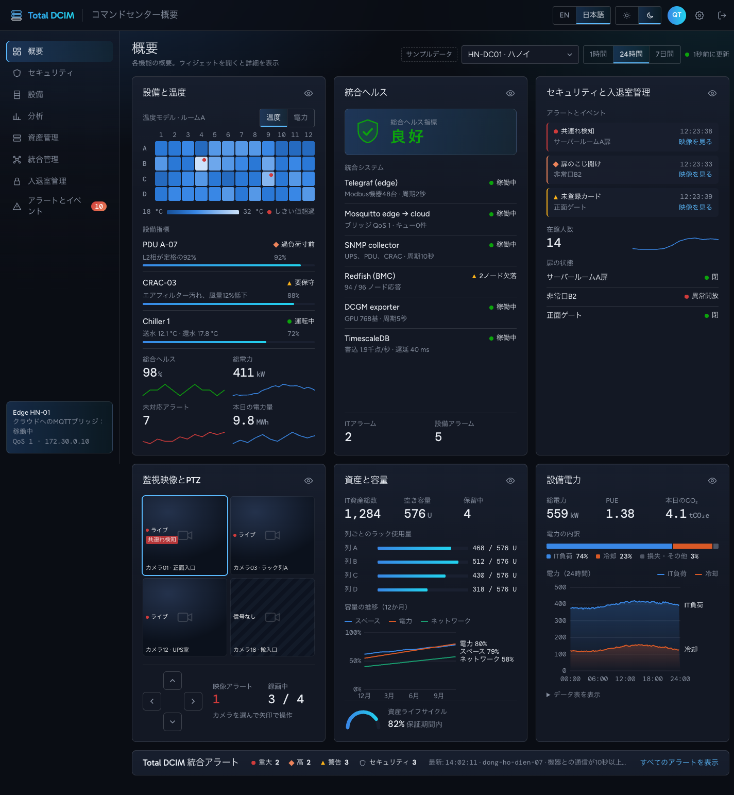

# Total DCIM · Dashboard template

Màn hình tổng quan (Command Center Summary) cho hệ thống DCIM của trung tâm dữ liệu AI/HPC: menu chức năng bên trái, 6 widget tóm tắt và dải cảnh báo hợp nhất ở cuối trang.



- **Ngôn ngữ:** tiếng Anh và tiếng Nhật (nút EN / 日本語 trên thanh trên cùng).
- **Giao diện:** sáng và tối; lần đầu mở theo cài đặt của hệ điều hành.
- **Widget:** cơ sở hạ tầng và nhiệt độ, sức khỏe tích hợp, an ninh và kiểm soát ra vào, video an ninh và PTZ, tài sản và dung lượng, điện năng cơ sở hạ tầng.
- **Số liệu:** toàn bộ là dữ liệu mẫu trong object `DATA` của `index.html`, thay bằng API thật khi tích hợp.

## Chạy trên máy

Cần Node.js và Python 3.

```bash
npm install                              # lần đầu: cài Tailwind CLI
npm run build                            # sinh dist/app.css
python3 -m http.server 8765 --bind 127.0.0.1
```

Mở http://127.0.0.1:8765.

## Cấu trúc

| File | Vai trò |
|---|---|
| `index.html` | Trang dashboard: HTML, dữ liệu mẫu, bảng dịch EN/JA và JavaScript |
| `src/input.css` | Nguồn Tailwind CSS v4: token màu cho hai theme, component dùng chung |
| `dist/app.css` | CSS đã build, trang tải file này. Không sửa tay |
| `docs/screenshot-ja.png` | Ảnh chụp dùng trong README |

## Khi sửa

- **Sửa class trong `index.html` hoặc sửa `src/input.css`:** chạy lại `npm run build` rồi commit cả `dist/app.css`.
- **Thêm chữ mới vào giao diện:** thêm một dòng `[khóa, en, ja]` vào mảng `I18N` trong `index.html`. Khóa là chuỗi gốc viết trong HTML hoặc trong `DATA`. Chữ không có trong bảng sẽ hiện nguyên chuỗi gốc.
- **Tự build lại khi lưu file:** `npm run dev`.
